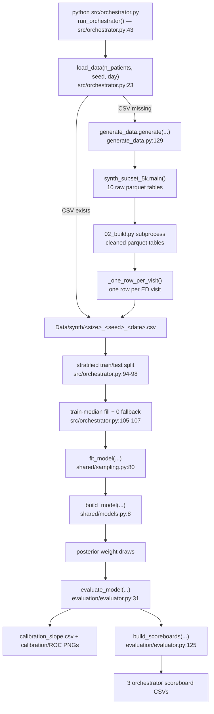

# Orchestrator flow and evaluation design

This document describes what `src/orchestrator.py` runs end to end, which evaluations it
produces, how the distribution-shift simulation is set up, what is being compared, and which
models are used. Metric definitions are in [`METRICS.md`](METRICS.md).

## 1. End-to-end flow



Run from the repository root:

```bash
PYTHONPATH=src python -m pytest -q Tests
PYTHONPATH=src python src/orchestrator.py --n-patients 5000 --seed 7 --quick
```

The `--quick` flag lowers `--iter`, `--burn` and `--chains` for a fast check. The run prints
timestamped stage logs for data loading/generation, split sizes, fit duration, evaluation,
scoreboard writing and total elapsed time.

## 2. Data

The generated CSV is named `<size>_<seed>_<date>.csv` under `Data/synth/`. The example run
uses `Data/synth/5K_7_2026-11-26.csv`:

| Property | Value |
|---|---|
| ED visits | `18,010` |
| Patients | `5,000` |
| Hospitals | `12` |
| Target | `died_30d` |
| Positive visits | `273` (`1.5%`) |

`load_data()` generates the file if it is missing, then reads it. It does not depend on the
generator return path; it re-globs the expected file name.

Features used by the orchestrator are defined in `src/orchestrator.py:16`:

```python
["age", "male", "body_temp", "systolic_bp", "pulse_rate", "n_vitals"]
```

Other generated columns are available in the CSV but are not used in this evaluation.

## 3. Stratified train/test split

`src/orchestrator.py:94-98` uses:

```python
stratify = y if y.value_counts().min() >= 2 else None
idx_train, idx_test = train_test_split(
    np.arange(len(X)), test_size=args.test_frac, random_state=args.seed,
    stratify=stratify,
)
```

The guard keeps custom targets with a constant label or a single event from crashing. For the
example CSV and seed `7`, this gives:

| Split | Visits | Events | Event rate |
|---|---:|---:|---:|
| Train | `12,607` | `191` | `1.51%` |
| Test | `5,403` | `82` | `1.52%` |

Stratification balances the event rate but does not group by patient, so the same patient can
still appear in both train and test.

`build_scoreboards()` receives the same `idx_train` and `idx_test`, so all scoreboard tables
use the same stratified split.

## 4. Models

### 4.1 Orchestrator model

Default method: **Bayesian logistic regression with Laplace approximation**.

- Gaussian prior on weights: `prior_prec = 1 / prior_std²` (`src/shared/models.py:19`).
- Posterior defined by `neg_log_posterior(w)` (`src/shared/models.py:21-23`).
- Laplace finds the MAP estimate by BFGS (`src/shared/sampling.py:29-35`).
- It then approximates the posterior as `N(w_map, inverse Hessian)` and samples from it
  (`src/shared/sampling.py:37-45`).

So the current `laplace logistic regression` label is still Bayesian logistic regression; it is
an approximate posterior method, not a non-Bayesian model. A clearer label would be
`Bayesian logistic regression (Laplace approximation)`. The label is currently generated at
`src/evaluation/evaluator.py:154` from `f"{method} logistic regression"`.

Available `--method` values (`src/orchestrator.py:48-54`):

| Method | Meaning |
|---|---|
| `laplace` | Gaussian approximation around MAP; default |
| `mcmc` | Random-walk Metropolis-Hastings; closer to exact posterior, slower |
| `bootstrap` | Repeated resampling with an L2 penalty; approximate uncertainty, not a full Bayesian posterior sampler |

### 4.2 Separate hospital-comparison models

Defined in `src/evaluation/run_hospital_comparison.py:53-65`. These belong to the separate
hospital-comparison pipeline, not to the orchestrator scoreboards.

| Key | Family | Prediction model | Missing-data handling |
|---|---|---|---|
| `B0` | Bayesian | Bayesian logistic regression | Joint imputation; missingness ignored |
| `B1` | Bayesian | Bayesian logistic regression | Joint imputation + hospital-wide measurement rule |
| `B2` | Bayesian | Bayesian logistic regression | Joint imputation + per-ward measurement rule |
| `B3` | Bayesian | Bayesian logistic regression | Joint imputation + missing-pattern flags |
| `B4` | Bayesian | Bayesian logistic regression | Per-ward rule + flags |
| `B5` | Bayesian | Bayesian logistic regression | Per-ward rule + shrunk own-value effects |
| `L1` | Standard | Ridge logistic regression | Mean imputation |
| `L2` | Standard | Ridge logistic regression | Mean imputation + missing flags |
| `L3` | Standard | Ridge logistic regression | MICE imputation |
| `L4` | Standard | Ridge logistic regression | MICE imputation + missing flags |
| `G1` | Standard | Gradient boosting | Native missing-value handling |
| `G2` | Standard | Gradient boosting | MICE imputation |

## 5. Evaluations produced

### 5.1 Primary single-model evaluation

`evaluate_model()` at `src/evaluation/evaluator.py:31` writes:

| Output | Contents |
|---|---|
| `Results/evaluation/calibration_slope.csv` | Posterior-aware metric summaries for the current model |
| `Results/evaluation/calibration_slope_calibration.png` | Calibration plot for posterior-mean risks |
| `Results/evaluation/calibration_slope_roc.png` | ROC plot for the binary target |

This is a sanity check for one model: the current `--method` with train-median imputation.

`plot_calibration()` in `src/evaluation/plots.py` splits held-out risks into 10 equal-count
bins and draws faint vertical lines at bin boundaries. Per-bin `n` and `events` counts are
computed by `calibration_bins()` for tests, but are not printed on the plot.

### 5.2 Orchestrator scoreboards

`build_scoreboards()` at `src/evaluation/evaluator.py:125` compares five missing-data strategies:

| Key | Handling |
|---|---|
| `median` | `SimpleImputer(strategy="median")` fit on train |
| `mean` | `SimpleImputer(strategy="mean")` fit on train |
| `mice` | `IterativeImputer(BayesianRidge)` fit on train |
| `mice_flags` | MICE plus binary missing indicators |
| `complete_case` | Drop rows with any missing feature |

The strategy list is at `src/evaluation/evaluator.py:22-28`; train/test transformation is at
`src/evaluation/evaluator.py:95-122`.

Three tables are written next to `--out` (`src/evaluation/evaluator.py:217-225`):

| File | Shape | Comparison |
|---|---|---|
| `orchestrator_scoreboard.csv` | Wide | All five strategies side by side; as recorded vs `50%` more deleted |
| `orchestrator_scoreboard_by_strategy.csv` | Long | Rows are strategy × deletion level within one prediction model |
| `orchestrator_scoreboard_by_hospital.csv` | Long | Rows are strategy × deletion level × hospital |

The old `Results/evaluation/scoreboard.csv` remains from the separate hospital-comparison
pipeline and is not overwritten by the orchestrator.

### 5.3 What is compared

1. **Missingness strategy**: does median, mean, MICE, MICE plus flags, or complete-case work
   best with the same prediction model and split?
2. **Robustness to more missingness**: how much do the metrics change when held-out vitals are
   artificially deleted?
3. **Hospital subgroup**: does the ranking of strategies hold inside each hospital?
4. **Legacy model family comparison**: the separate hospital pipeline compares Bayesian models
   with and without missingness rules/flags against ridge logistic regression and gradient
   boosting.

Ranking in the wide scoreboard uses negative log likelihood as recorded, restricted to rows
with at least `5` events (`src/evaluation/evaluator.py:206-208`). In the example run, all five
strategies are rankable because complete-case has `11` events, but it keeps only `853` of the
`5,403` test visits and has `0` events after `50%` deletion, so its high rank should be read with
that caveat.

## 6. Distribution-shift simulation attempt

The orchestrator simulates a **measurement-practice shift**: held-out feature values become
missing more often after deployment.

For each deletion level in `[0.0, 0.25, 0.5]`, the evaluator copies the held-out feature matrix
and sets each observed cell to `NaN` with probability equal to the level
(`src/evaluation/evaluator.py:146-152`):

```python
Xd[~np.isnan(Xd) & (rng.random(Xd.shape) < level)] = np.nan
```

This keeps:

- the same patients
- the same labels
- the same underlying feature values
- the same train set and fitted imputers

Only the observation pattern changes. This is an MCAR-style deletion on top of the synthetic
data's existing missingness. It does **not** simulate a shift in outcome prevalence, feature
values, patient case mix, or disease mechanism.

In the example run, the deletion levels have this effect on complete-case:

| Deletion | Complete-case `n` | Complete-case events |
|---|---:|---:|
| `0.0` | `853` | `11` |
| `0.25` | `156` | `2` |
| `0.5` | `12` | `0` |

Complete-case keeps far fewer visits than the imputation strategies. Its `50%` deletion row has
no events, so AUC, calibration and O:E are blank there.

The separate hospital simulator creates a richer shift: ward-level recording behavior and a
shared “lab panel ordered” gate where all five labs go missing together
(`src/evaluation/simulate_hospital.py:69-96`). The B0-B5 models exist to test different
responses to that more realistic measurement shift.

## 7. Metric interpretation

Brief interpretation; full definitions are in [`METRICS.md`](METRICS.md).

| Metric | Direction |
|---|---|
| AUC | Higher is better; `NaN` if only one class is present |
| Brier score | Lower is better |
| Negative log likelihood | Lower is better; also called log-loss |
| O:E ratio | `1` is ideal; `<1` overprediction, `>1` underprediction |
| Calibration slope | `1` is ideal; `<1` over-extreme predictions, `>1` under-extreme predictions |
| AUC drop | More negative means less robust to the `50%` deletion shift |

`n` and `events` matter as much as the metric values. With few events, AUC, calibration and O:E
are unstable or undefined.
